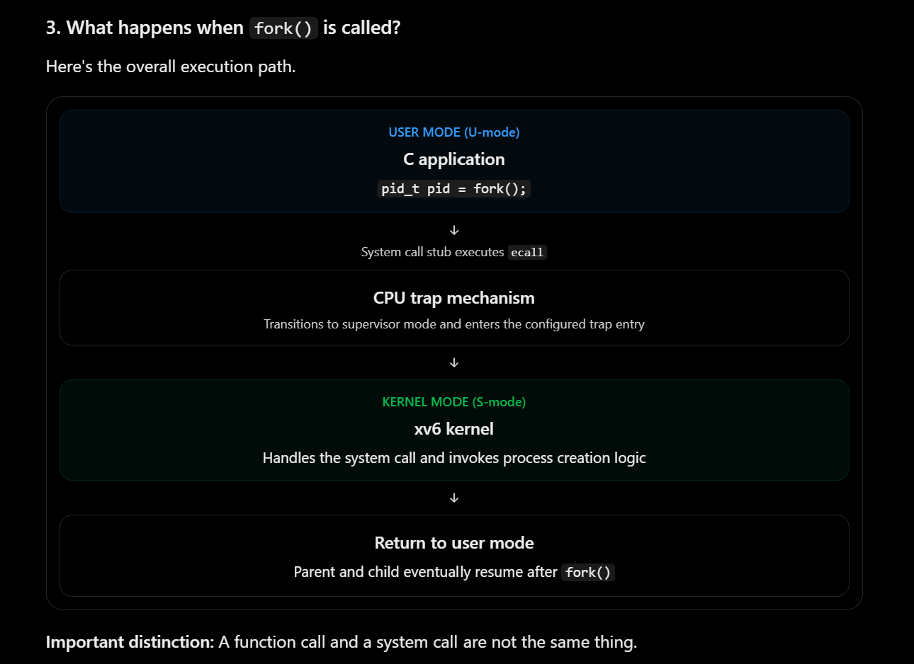
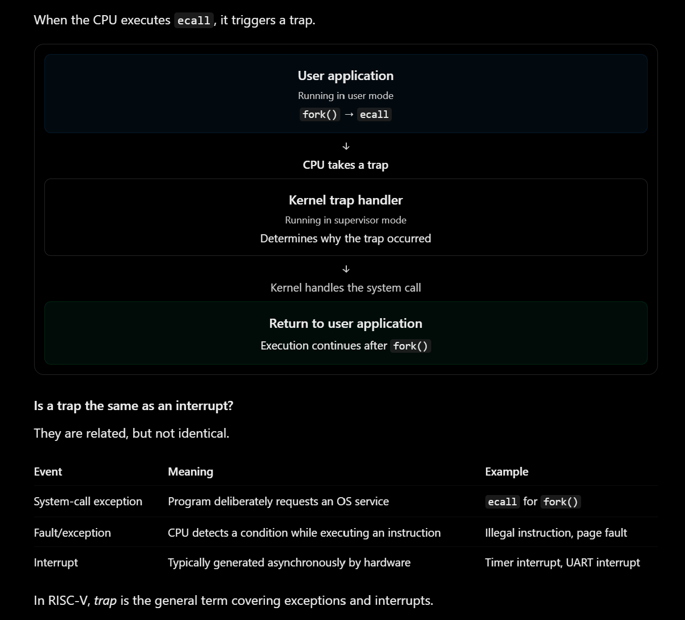
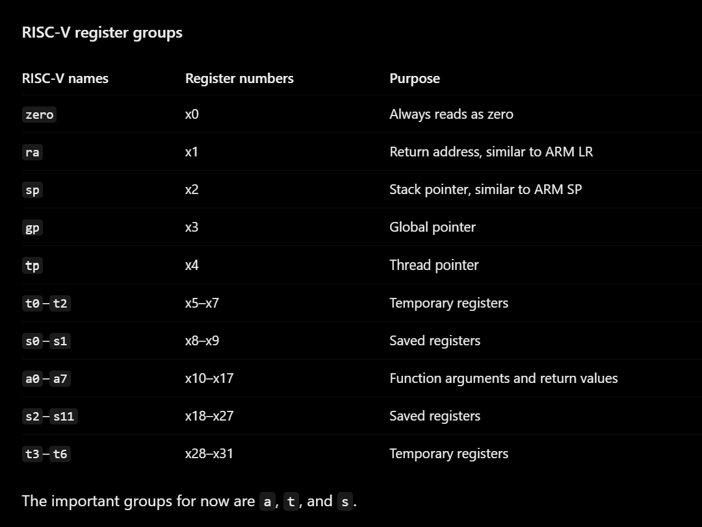
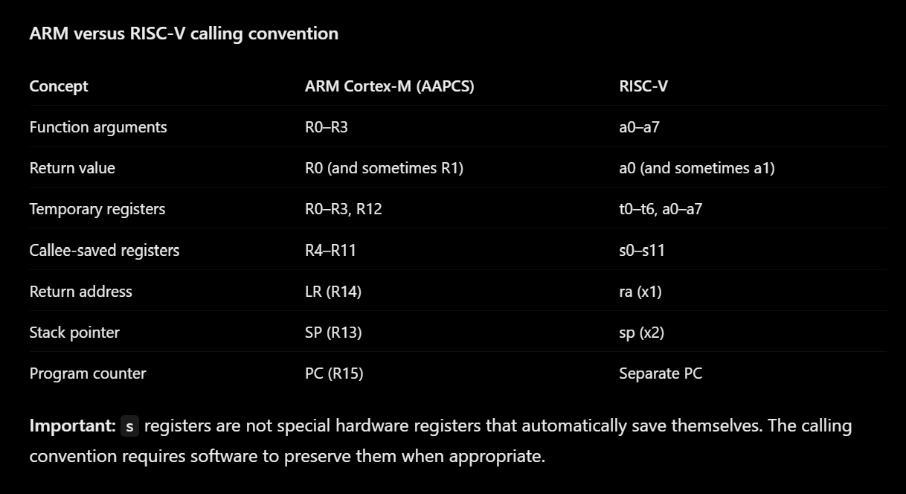
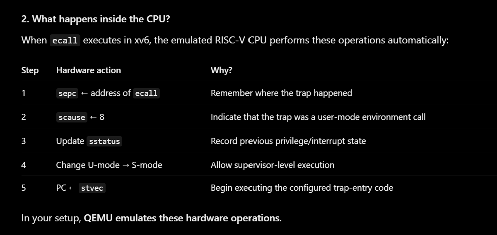
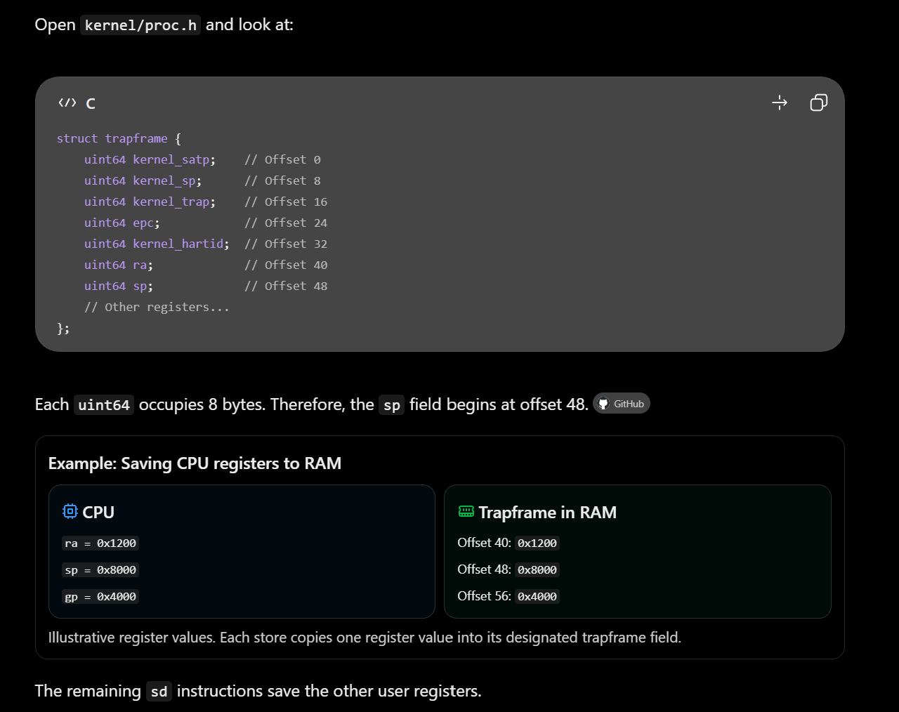
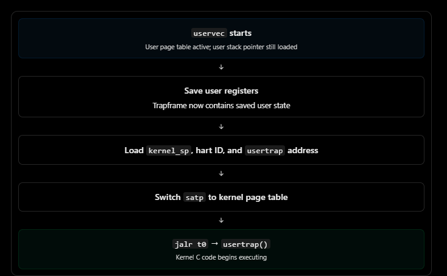

# Operating Systems Learning

## Topic 1: Process Creation using fork()

### What is fork()?

The `fork()` system call creates a new process
called the child process.

#include "user/user.h" - This header declares the fork() function so the compiler knows its interface. in XV6

### Example Code

```c
#include <stdio.h>
#include <unistd.h>

int main(void)
{
    pid_t pid = fork();

    if (pid == 0)
        printf("Child Process\n");
    else
        printf("Parent Process\n");

    return 0;
}
```

### What happens inside the kernel?

1. The parent process calls `fork()`.
2. The kernel creates a child process.
3. The child receives its own virtual address space.
4. Both processes continue executing after `fork()`.

### Important Points

- Parent receives the child's PID.
- Child receives 0.
- On failure, `fork()` returns -1.


### notes
`pid_t pid = fork();`

This looks like an ordinary function call. But creating a process requires operations that a normal application is not permitted to perform directly.

The operating system must create a new process. That involves:
- Allocating a kernel process structure.
- Assigning a new PID.
- Setting up memory mappings for the child.
- Preparing the child's CPU execution context.
- Adding the child to the scheduler's runnable processes.

A normal C function call transfers execution to another function while remaining in the same privilege mode.

A system call uses a CPU-defined mechanism to request a privileged kernel operation.

Now imagine that any application could directly modify these kernel structures.

A buggy or malicious application could change another process's memory mappings, modify its execution state, or interfere with the scheduler.

This is why the CPU provides privilege separation.

<p align="center">
  
</p>

### basics before looking into xv6 code

1. What is a trap?

A trap is an event that causes the CPU to temporarily stop its current execution flow and transfer control to a designated handler, typically in the operating system.

In RISC-V, trap is the general term covering exceptions and interrupts. A trap is the mechanism that allows the CPU to redirect execution to a handler when a system call, exception, or interrupt occurs.

<p align="center">
  
</p>


## XV6 example - what happens when fork called in XV6?

Flow:

```
user/usys.pl
    |
    | generates fork syscall stub
    v
ecall
    |
    | CPU enters supervisor mode
    v
kernel/trampoline.S
    |
    | uservec saves user registers
    v
kernel/trap.c
    |
    | usertrap() handles trap
    v
kernel/syscall.c
    |
    | syscall() dispatches request
    v
kernel/sysproc.c
    |
    | sys_fork()
    v
kernel/proc.c
    |
    | fork()
    v
Child process creation
```

usys = user system-call stubs
.pl = perl script, Perl is a programming language commonly used for text processing and code generation.
usys.pl - The file is not part of the xv6 kernel's runtime execution. Instead, it is used during compilation to generate assembly code.

#### why do we need usys.pl?

Imagine xv6 supports these system calls:

```
fork();
exit();
wait();
read();
write();
```

Each one needs a small assembly wrapper that enters the kernel. Rather than manually writing similar assembly code for every system call, xv6 uses a generator.

The script generates a file called user/usys.S, containing assembly implementations of the user-side wrappers.

#### What does a stub mean?
In software engineering, a stub is a small piece of code that stands in for or provides an interface to another operation.

example:

```
.pl - entry("fork");

.asm
fork:
    li a7, SYS_fork
    ecall
    ret
```

fork - Label identifying the wrapper function
li a7, SYS_fork	- Places the system-call number in register a7
ecall - Causes the CPU to take a trap into the kernel
ret - Returns to the calling C code after the system call completes

The wrapper simply provides the entry point between your C application and the system-call mechanism.

```
C application
    |
    | fork()
    v
System-call stub
    |
    | ecall
    v
Kernel
    |
    | Creates child process
    v
Returns result
```

When we say the RISC-V CPU switches from U-mode to S-mode, it's QEMU emulating that hardware behavior.

#### QEMU - quick emulator

QEMU is an open-source emulator and virtualizer that allows us to run operating systems and software designed for different CPU architectures without requiring physical hardware.

QEMU allows us to execute and debug RISC-V operating systems like xv6 on an x86-64 computer without owning a physical RISC-V processor.

XV6 is return for RISC V processor, which is emulated with QEMU

#### What happens to CPU registers when a trap occurs?

RISC V Register groups 

<p align="center">
  
</p>

RISC V & ARM calling conventions
<p align="center">
  
</p>

How can the kernel use CPU registers without destroying the user's values?
Here there are two concepts involved trap frame and context

```
User program
    |
    | ecall
    v
Save user registers → Trapframe
    |
    v
Kernel handles system call
    |
    v
Restore user registers ← Trapframe
    |
    v
User program resumes
```

trapframe is used when kernel switches to new process and context is used when the task gets premmpted so that kernal has to save all the current executing task onto memory usually stack

when trap has occured which is happened while the ecall instruiction is exceuted, the hardware acknowledges the exeption request

What exactly does RISC-V hardware do when ecall executes? why we involve hardware?
Before ecall, the CPU executes your application in user mode (U-mode).The kernel needs supervisor privileges to access protected kernel structures and manage processes. So the CPU must safely transfer execution into supervisor mode.


<p align="center">
  
</p>

entering supervisor mode does not automatically give the CPU a new stack or a new set of registers.

If you check trampoline.s
you will find
```
sd ra, 40(a0)
sd sp, 48(a0)
sd gp, 56(a0)
sd tp, 64(a0)
sd t0, 72(a0)
```

li a0, TRAPFRAME - a0 contains the base address of the trap frame

'sd sp, 48(a0)' what does this mean? - sp = Memory[a0 + 48] which contains the stack pointer

<p align="center">
  
</p>


The CPU has entered supervisor mode, but it is still using the user's page table and hasn't switched to the process's kernel stack. How can it safely execute kernel C code?

## Switching from the user environment to the kernel environment

```
User program
    |
    | fork()
    v
System-call stub
    |
    | a7 = SYS_fork
    | ecall
    v
RISC-V hardware trap
    |
    | U-mode → S-mode
    v
trampoline.S : uservec
    |
    | Save user registers into trapframe
    v
WE ARE HERE
```

Component -	Current state,
Privilege mode - 	Supervisor mode,
CPU general-purpose registers	- User values saved in trapframe,
sp	- Still holds the user's stack pointer,
Active page table	- User page table,
Kernel fork()	- Not executed yet,

Open kernel/trampoline.S

Immediately after the instructions that save the user's registers, you'll find:

```
# Initialize kernel stack pointer
ld sp, 8(a0)

# Load current CPU/hart ID
ld tp, 32(a0)

# Load address of usertrap()
ld t0, 16(a0)

# Load kernel page table value
ld t1, 0(a0)

sfence.vma zero, zero

# Switch to kernel page table
csrw satp, t1

sfence.vma zero, zero

# Jump to usertrap()
jalr t0
```
user process already has its own stack.

But the kernel cannot safely rely on the user's stack while performing privileged operations.

Why?

Because the user stack belongs to the user process's memory environment. Its mapping and contents may be unsuitable or maliciously manipulated, and kernel execution needs a protected stack of its own.

Therefore, xv6 gives each process a separate kernel stack.

Notice that this is different from the trapframe.
- Trapframe: preserves the application's CPU register state.
- Kernel stack: supports kernel function execution.


```
ld sp, 8(a0)
```

Sp means stack pointer here, and ld means load double. And here a zero is the base address, and from the base address we are offsetting eight. And usually this contains the address of the stack pointer. That's what this instruction is doing.

Important: RISC-V does not have a separate physical sp register for the user and kernel. The same register receives a different pointer value.

The original user sp was saved earlier in the trapframe, so it can be restored when returning to user mode.

Instruction: ld tp, 32(a0)

This loads the current hardware thread identifier (hart ID) into the tp register.

A **hart** is a RISC-V hardware execution context. In a multicore emulated system, each hart can execute instructions independently.

xv6 uses tp to help identify the current CPU.

Why is this needed?

Because kernel code may need to access CPU-specific information, such as the current process or scheduler state.

For now, remember:

tp identifies the current hart for xv6's kernel code.

**Switching to the kernel page table**

ld t1, 0(a0)

The field at offset 0 is kernel_satp.

It contains the value needed to activate the kernel page table.

```
sfence.vma zero, zero
csrw satp, t1
sfence.vma zero, zero
```

The satp register controls the active address-translation configuration in RISC-V supervisor mode.

Writing the kernel's satp value activates the kernel page-table configuration.

The comple flow looks like:
<p align="center">
  
</p>

satp is a RISC-V control register used to configure address translation, including the active page-table root.