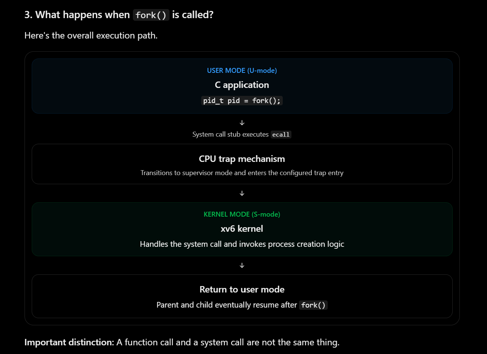
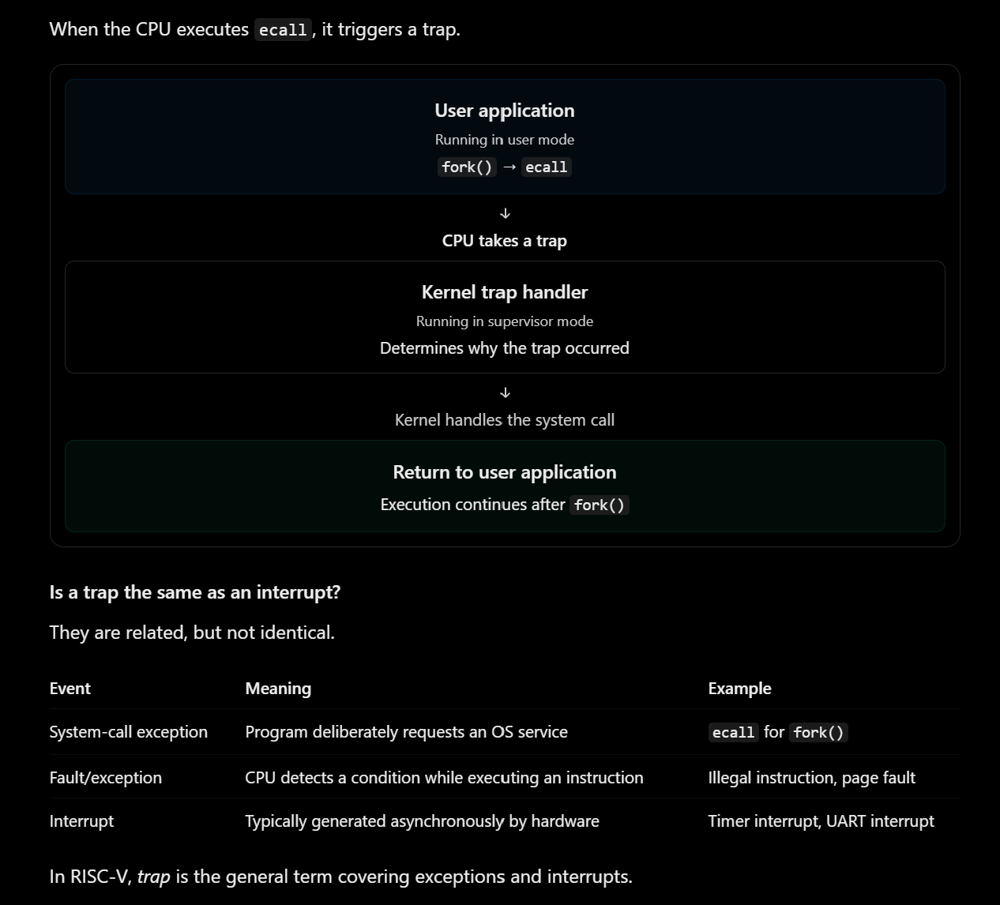

# Operating Systems Learning

## Topic 1: Process Creation using fork()

### What is fork()?

The `fork()` system call creates a new process
called the child process.

### Example Code

```c
#include <stdio.h>
#include <unistd.h>

int main(void)
{
    pid_t pid = fork();

    if (pid == 0)
        printf("Child Process\n");
    else
        printf("Parent Process\n");

    return 0;
}
```

### What happens inside the kernel?

1. The parent process calls `fork()`.
2. The kernel creates a child process.
3. The child receives its own virtual address space.
4. Both processes continue executing after `fork()`.

### Important Points

- Parent receives the child's PID.
- Child receives 0.
- On failure, `fork()` returns -1.


### notes
`pid_t pid = fork();`

This looks like an ordinary function call. But creating a process requires operations that a normal application is not permitted to perform directly.

The operating system must create a new process. That involves:
- Allocating a kernel process structure.
- Assigning a new PID.
- Setting up memory mappings for the child.
- Preparing the child's CPU execution context.
- Adding the child to the scheduler's runnable processes.

A normal C function call transfers execution to another function while remaining in the same privilege mode.

A system call uses a CPU-defined mechanism to request a privileged kernel operation.

Now imagine that any application could directly modify these kernel structures.

A buggy or malicious application could change another process's memory mappings, modify its execution state, or interfere with the scheduler.

This is why the CPU provides privilege separation.

<p align="center">
  
</p>

### basics before looking into xv6 code

1. What is a trap?

A trap is an event that causes the CPU to temporarily stop its current execution flow and transfer control to a designated handler, typically in the operating system.

In RISC-V, trap is the general term covering exceptions and interrupts. A trap is the mechanism that allows the CPU to redirect execution to a handler when a system call, exception, or interrupt occurs.

<p align="center">
  
</p>


## XV6 example - what happens when fork called in XV6?

Flow:

```
user/usys.pl
    |
    | generates fork syscall stub
    v
ecall
    |
    | CPU enters supervisor mode
    v
kernel/trampoline.S
    |
    | uservec saves user registers
    v
kernel/trap.c
    |
    | usertrap() handles trap
    v
kernel/syscall.c
    |
    | syscall() dispatches request
    v
kernel/sysproc.c
    |
    | sys_fork()
    v
kernel/proc.c
    |
    | fork()
    v
Child process creation
```

usys = user system-call stubs
.pl = perl script, Perl is a programming language commonly used for text processing and code generation.
usys.pl - The file is not part of the xv6 kernel's runtime execution. Instead, it is used during compilation to generate assembly code.

#### why do we need usys.pl?

Imagine xv6 supports these system calls:

```
fork();
exit();
wait();
read();
write();
```

Each one needs a small assembly wrapper that enters the kernel. Rather than manually writing similar assembly code for every system call, xv6 uses a generator.

The script generates a file called user/usys.S, containing assembly implementations of the user-side wrappers.

#### What does a stub mean?
In software engineering, a stub is a small piece of code that stands in for or provides an interface to another operation.

example:

```
.pl - entry("fork");

.asm
fork:
    li a7, SYS_fork
    ecall
    ret
```

fork - Label identifying the wrapper function
li a7, SYS_fork	- Places the system-call number in register a7
ecall - Causes the CPU to take a trap into the kernel
ret - Returns to the calling C code after the system call completes

The wrapper simply provides the entry point between your C application and the system-call mechanism.

```
C application
    |
    | fork()
    v
System-call stub
    |
    | ecall
    v
Kernel
    |
    | Creates child process
    v
Returns result
```

When we say the RISC-V CPU switches from U-mode to S-mode, it's QEMU emulating that hardware behavior.

#### QEMU - quick emulator

QEMU is an open-source emulator and virtualizer that allows us to run operating systems and software designed for different CPU architectures without requiring physical hardware.

QEMU allows us to execute and debug RISC-V operating systems like xv6 on an x86-64 computer without owning a physical RISC-V processor.

XV6 is return for RISC V processor, which is emulated with QEMU