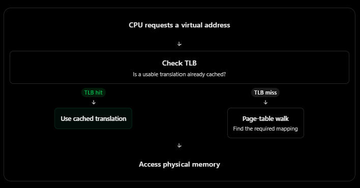

# Paging

Paging is a memeory managment techique

## What is paging, and why do operating systems need it?

First, what problem are we solving?
Imagine your computer has 8 GB of physical RAM.

You execute three programs:
- Program A needs 100 MB.
- Program B needs 200 MB.
- Program C needs 150 MB.
Without virtual memory, imagine that each program must work directly with physical RAM addresses.

This creates several problems.

**Problem 1: Memory isolation**

What if Program A accidentally writes into Program B's memory?

That could corrupt Program B's data or crash it.

**Problem 2: Memory allocation**

What if a program needs 200 MB, but the available RAM is scattered across several smaller regions?

Finding one large contiguous region would be difficult.

**Problem 3: Program relocation**

What if a program expects its data at a particular address, but that physical RAM location is already occupied?

We need a way to make programs independent of where their data actually resides in RAM.

That's where virtual memory and paging come in.

<p align="center">
  
</p>

-   Your program uses a virtual address.
-   Physical RAM contains the actual data.
-   The operating system establishes the mapping.
-   The CPU's MMU uses that mapping to access the correct physical location.

A page table is a data structure that records how virtual pages map to physical frames, along with information such as access permissions.

The operating system creates and manages these mappings. The MMU uses them during address translation.

Example: Translating an address
Suppose:
- Page size = 4096 bytes (4 KB).
- Your program accesses virtual address 0x1234.
- Virtual Page 1 maps to Physical Frame 3.
First, split the virtual address:

**0x1234 = 0x1000 + 0x234**


Therefore:
- Virtual page number = 1.
- Offset within the page = 0x234.
Frame 3 starts at physical address 0x3000.

So the physical address becomes:
**0x3000 + 0x234 = 0x3234**

For 4 KB pages, the offset occupies 12 bits because \(4096=2^{12}\).

You learned that the child and parent have independent virtual address spaces.

Now you can understand how that is possible.

Each process has its own page-table mappings.

## Questions on paging

**Q1. What is the difference between virtual memory and physical memory?**

Virtual memory is the address space presented to a process. Physical memory is the actual RAM hardware. The MMU translates virtual addresses to physical addresses using page-table mappings.

**Q2. Why does an operating system use paging?**

Paging allows noncontiguous physical memory allocation, provides address-space isolation, enables access protection, and supports efficient memory-management techniques such as sharing and copy-on-write.

**Q3. If the page size is 4 KB, how many bits represent the offset?**

12 bits, since \(2^{12}=4096\).

**Q4. Can two processes have the same virtual address but different values?**

Yes. They can have different page-table mappings, so identical virtual addresses access different physical frames.

**Q5. Does every virtual page always occupy physical RAM?**

No. A virtual page may be unmapped or, in a system supporting demand paging and swapping, may not currently reside in RAM. Access to such a page may generate a page fault.

**Q6. Does the CPU consult the operating system for every memory access?**

No. The MMU performs address translation using hardware mechanisms and page tables. A TLB can cache recent translations to accelerate access. The OS manages the mappings and handles faults when necessary.

Paging: Dividing virtual memory into pages and physical RAM into frames.
Page table: A data structure that maps virtual pages to physical frames.
Virtual address: The address used by a program.
Physical address: The address used to access physical memory.

Your CPU executes instructions. The MMU translates memory addresses. The RAM stores the actual data.

**What happens when the CPU accesses a variable?**

```
int global = 100;

int main(void)
{
    int x = global;
    return 0;
}
```

<p align="center">
  
</p>

Virtual address = Page number + Offset

If every load or store required multiple RAM accesses to walk the page table, memory access could become expensive.

To reduce that cost, CPUs use a Translation Lookaside Buffer (TLB).

A TLB is a small hardware cache of recently used virtual-to-physical address translations.

<p align="center">
  
</p>

What is the difference between a TLB miss and a page fault?

A TLB miss means the translation is not cached. A page fault means translation or permission checking encountered a condition requiring fault handling.

### Coming back to XV6

Because xv6 separates the user process's address mappings from the kernel's normal address mappings.

The kernel needs access to its own code, data, devices, and per-process kernel stack.

The trampoline prepares that environment by activating the kernel page table.

Importantly, switching privilege modes and switching page tables are different operations.
- ecall triggers the CPU's privilege transition.
- The trampoline later changes the active page-table configuration.