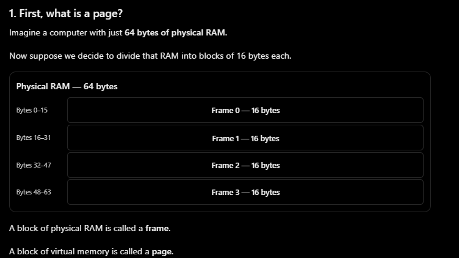
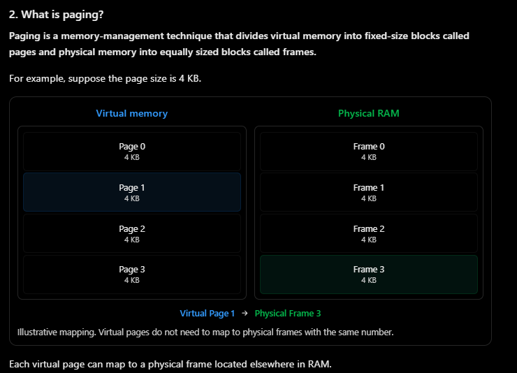
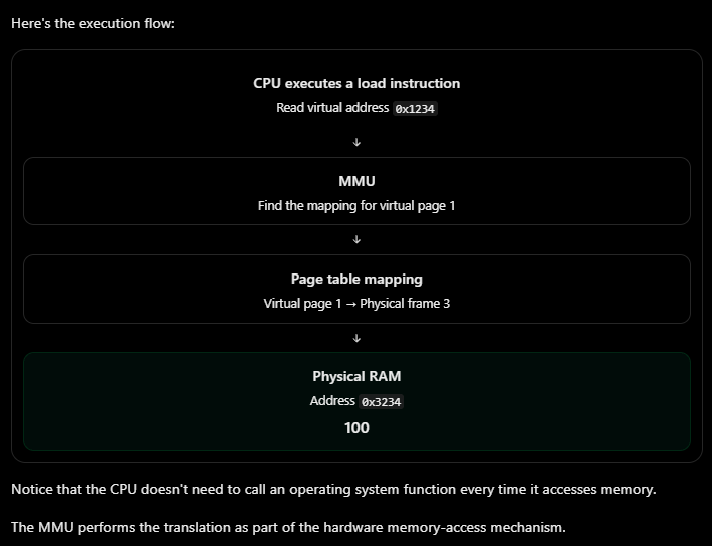
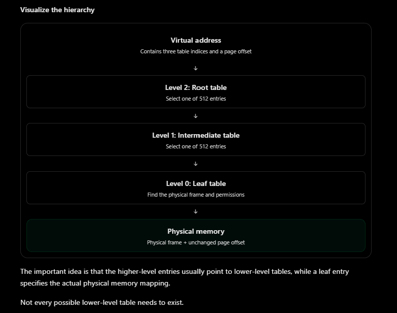

# Paging

Paging is a memeory managment techique

## What is paging, and why do operating systems need it?

First, what problem are we solving?
Imagine your computer has 8 GB of physical RAM.

You execute three programs:
- Program A needs 100 MB.
- Program B needs 200 MB.
- Program C needs 150 MB.
Without virtual memory, imagine that each program must work directly with physical RAM addresses.

This creates several problems.

**Problem 1: Memory isolation**

What if Program A accidentally writes into Program B's memory?

That could corrupt Program B's data or crash it.

**Problem 2: Memory allocation**

What if a program needs 200 MB, but the available RAM is scattered across several smaller regions?

Finding one large contiguous region would be difficult.

**Problem 3: Program relocation**

What if a program expects its data at a particular address, but that physical RAM location is already occupied?

We need a way to make programs independent of where their data actually resides in RAM.

<p align="center">
  
</p>

That's where virtual memory and paging come in.

<p align="center">
  
</p>

-   Your program uses a virtual address.
-   Physical RAM contains the actual data.
-   The operating system establishes the mapping.
-   The CPU's MMU uses that mapping to access the correct physical location.

A page table is a data structure that records how virtual pages map to physical frames, along with information such as access permissions.

The operating system creates and manages these mappings. The MMU uses them during address translation.

Example: Translating an address
Suppose:
- Page size = 4096 bytes (4 KB).
- Your program accesses virtual address 0x1234.
- Virtual Page 1 maps to Physical Frame 3.
First, split the virtual address:

**0x1234 = 0x1000 + 0x234**


Therefore:
- Virtual page number = 1.
- Offset within the page = 0x234.
Frame 3 starts at physical address 0x3000.

So the physical address becomes:
**0x3000 + 0x234 = 0x3234**

For 4 KB pages, the offset occupies 12 bits because \(4096=2^{12}\).

You learned that the child and parent have independent virtual address spaces.

Now you can understand how that is possible.

Each process has its own page-table mappings.

## Questions on paging

**Q1. What is the difference between virtual memory and physical memory?**

Virtual memory is the address space presented to a process. Physical memory is the actual RAM hardware. The MMU translates virtual addresses to physical addresses using page-table mappings.

**Q2. Why does an operating system use paging?**

Paging allows noncontiguous physical memory allocation, provides address-space isolation, enables access protection, and supports efficient memory-management techniques such as sharing and copy-on-write.

**Q3. If the page size is 4 KB, how many bits represent the offset?**

12 bits, since \(2^{12}=4096\).

**Q4. Can two processes have the same virtual address but different values?**

Yes. They can have different page-table mappings, so identical virtual addresses access different physical frames.

**Q5. Does every virtual page always occupy physical RAM?**

No. A virtual page may be unmapped or, in a system supporting demand paging and swapping, may not currently reside in RAM. Access to such a page may generate a page fault.

**Q6. Does the CPU consult the operating system for every memory access?**

No. The MMU performs address translation using hardware mechanisms and page tables. A TLB can cache recent translations to accelerate access. The OS manages the mappings and handles faults when necessary.

Paging: Dividing virtual memory into pages and physical RAM into frames.
Page table: A data structure that maps virtual pages to physical frames.
Virtual address: The address used by a program.
Physical address: The address used to access physical memory.

Your CPU executes instructions. The MMU translates memory addresses. The RAM stores the actual data.

**What happens when the CPU accesses a variable?**

```
int global = 100;

int main(void)
{
    int x = global;
    return 0;
}
```

<p align="center">
  
</p>

Virtual address = Page number + Offset

If every load or store required multiple RAM accesses to walk the page table, memory access could become expensive.

To reduce that cost, CPUs use a Translation Lookaside Buffer (TLB).

A TLB is a small hardware cache of recently used virtual-to-physical address translations.

<p align="center">
  
</p>

What is the difference between a TLB miss and a page fault?

A TLB miss means the translation is not cached. A page fault means translation or permission checking encountered a condition requiring fault handling.

### Coming back to XV6

Because xv6 separates the user process's address mappings from the kernel's normal address mappings.

The kernel needs access to its own code, data, devices, and per-process kernel stack.

The trampoline prepares that environment by activating the kernel page table.

Importantly, switching privilege modes and switching page tables are different operations.
- ecall triggers the CPU's privilege transition.
- The trampoline later changes the active page-table configuration.


# Multi-Level Page Tables in RISC-V (Sv39)

Why does an operating system need multiple levels of page tables, and how does the MMU use them to find physical memory?

<p align="center">
  
</p>

### Understanding Multi-Level Paging in RISC-V (Sv39)

Let's first take a simple example of a 4-bit virtual address. Since we have 4 bits to represent an address, we can represent \(2^4 = 16\) different byte addresses, assuming byte-addressable memory.

Similarly, RISC-V uses an addressing scheme called **Sv39**, which uses 39 significant bits for virtual addressing. This means we can represent \(2^{39}\) different virtual byte addresses. However, this doesn't necessarily mean that the system has \(2^{39}\) bytes of physical RAM. It simply defines the virtual address range supported by this addressing scheme, and a process doesn't necessarily use all those addresses.

Now, in xv6, **each page has a size of 4 KiB**, which is \(4096 = 2^{12}\) bytes. The corresponding physical memory frames are also 4 KiB in size. Since each page contains \(2^{12}\) byte positions, we need **12 bits to identify the offset within a page**.

So, out of the 39 significant virtual address bits, 12 bits are used for the page offset, and the remaining bits are used to identify the virtual page number.

\[
39-12=27\text{ bits}
\]

Therefore, the virtual address is divided into:

- **27 bits:** Virtual Page Number (VPN), identifying which virtual page is being accessed.
- **12 bits:** Page offset, identifying the byte within that page.

This means the Sv39 address space can represent:

\[
2^{27}=134,217,728\text{ virtual pages}
\]

Now comes the problem. The operating system needs a **page table**, which is a data structure stored in memory, to maintain the mapping between virtual pages and physical memory frames.

Suppose we implement a simple single-level page table containing one entry for every possible virtual page. In Sv39, each Page Table Entry (PTE) occupies **8 bytes**.

Therefore, the total memory needed for such a flat page table would be:

\[
2^{27}\times8=2^{30}\text{ bytes}=1\text{ GiB}
\]

This means a fully allocated, single-level page table covering the entire Sv39 virtual address range would consume **1 GiB of memory**, even if the process actually uses only a small portion of that address space.

The problem is that we are unnecessarily allocating page-table memory for virtual pages that the process never uses.

**This is why multi-level paging is introduced.**

Instead of maintaining one enormous flat page table, we divide the page-to-frame mapping into a **hierarchical, tree-like structure**, consisting of a root page table, intermediate page tables, and leaf entries.

The root and intermediate entries help us navigate through the hierarchy, while the leaf entries provide the actual virtual-to-physical memory mappings.

The important advantage is that **we don't need to allocate every possible node in the tree**. We allocate lower-level page tables only for the virtual address regions that require mappings. If an entire region of virtual memory is unused, the corresponding lower-level page tables need not exist.

In this way, multi-level paging significantly reduces page-table memory consumption for processes that use only a small portion of their available virtual address space.

**Key takeaway:** Multi-level paging doesn't reduce the actual memory required by the program's data. Instead, it reduces the overhead of storing virtual-to-physical address mappings by avoiding unnecessary page-table allocations.

All three levels of page tables are stored in physical RAM.

They are ordinary memory structures created and maintained by the operating system.

The root table contains entries pointing to intermediate tables. Intermediate tables contain entries pointing to other tables. Leaf entries map virtual pages to the physical frames holding program data.

# Page Table Entries (PTEs) and Memory Permissions

Just because a virtual address maps to physical RAM, should a program be allowed to read, write, or execute anything at that address?

So in page table entry doesn't only contain the page number to the frame mapping. It also consists of flags which the kernel can use to identify the memory access restrictions.

V = 1  Valid mapping
R = 1  Reading permitted
W = 0  Writing not permitted
X = 1  Instruction execution permitted
U = 1  User-mode access permitted


### Case A - user code page

V=1, R=1, W=0, X=1, U=1
Your program can execute instructions from the page.
But if it tries to write to that page, the MMU rejects the operation and raises an exception.

### Case B — User data page

V=1, R=1, W=1, X=0, U=1
Your program can read and modify variables stored in the page.
However, it cannot execute instructions from that page.
This helps prevent accidental or malicious execution of data as code.

### Case C — Kernel code page
V=1, R=1, W=0, X=1, U=0
The U=0 bit means user-mode code cannot directly access this page.
Supervisor-mode access follows additional RISC-V privilege rules; U=0 does not by itself grant unrestricted access.
This is one part of how the OS protects kernel code from applications.

What happens when a program violates a permission?

Virtual address → 0x4000

Page table entry:
V=1, R=1, W=0, X=1, U=1

The CPU attempts a store instruction. The MMU checks the PTE and sees W=0. The write is not permitted.
The CPU raises a store page-fault exception, transferring control to the kernel's trap handler.