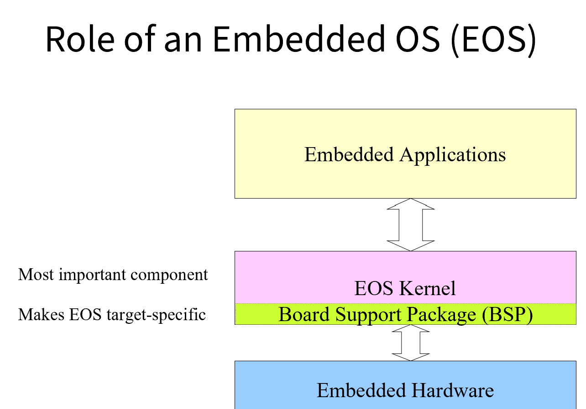
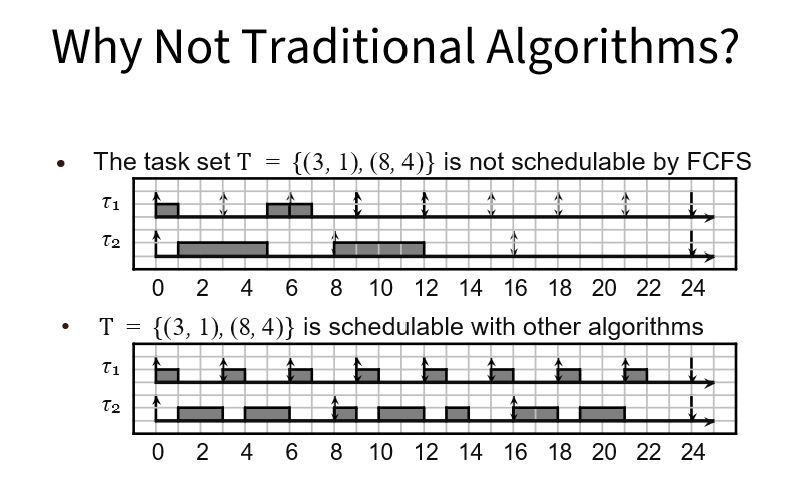
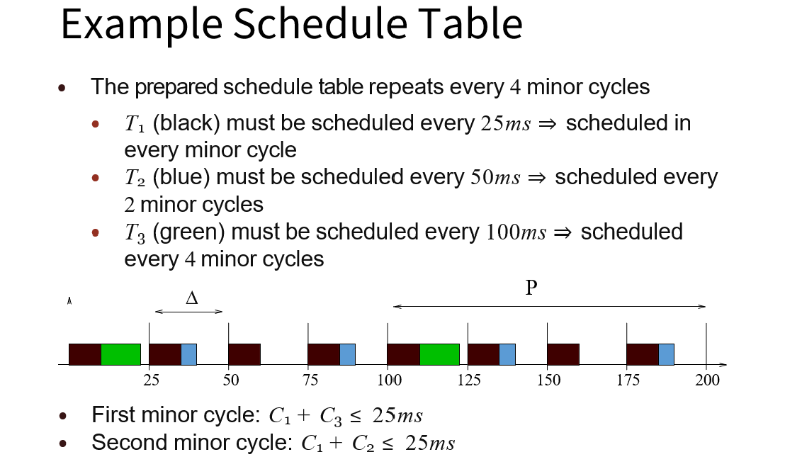
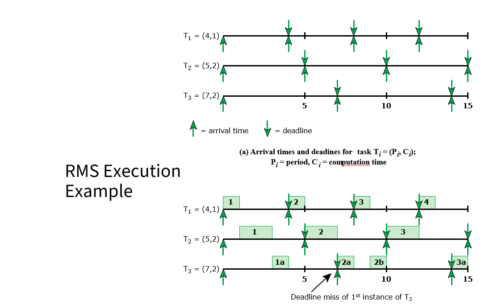

# Embedded OS

## Real time system

A real-time system is a system whose correctness depends on both what result it produces and when it produces that result.

Suppose a button controls a light. The requirement says, “When the button is pressed, the light must turn on within 2 seconds.”
- You press the button at 5 seconds. That is the event.
- The system’s task is to turn on the light.
- The deadline is 7 seconds because \(5 + 2 = 7\).
- If the light turns on at 6 seconds, the response time is 1 second because \(6 - 5 = 1\).
Now suppose the light turns on at 8 seconds. The system produced the correct action, but its response took 3 seconds. It missed the deadline by 1 second.

### Embedded OS
An embedded OS is a system software which allocates the resources based on the request for each program running in the system. So the operating system, especially in embedded system, makes use something called as a schedule, which is an algorithm which can assign the tasks to the CPU. So let's take an example that we have one core and we have two tasks. let's say the two tasks are in ready state. We need the scheduler decides which task to run and which to put into wait state. Once the task gets completed, the scheduler assigns the another task to the CPU.

### How an embedded operating system fits into a device?

  

So in the image attached, we have embedded application, embedded OS kernel, a board support package, and embedded hardware. So we call the embedded hardware as a target, and let's say, the embedded OS is generic, and the target can vary from board to board, and let's say the embedded application wants to set the LED to turn on. For example, the target A has the LED pin connected to pin 13, and target B has the connection to LED at pin 10. we don't have to change the kernel based on every target. We just have to change the board support package. Now the board support package Has the details and specifics of each embedded hardware or the target, so in this way, the embedded OS can be generic. Embedded applications can be generic, and the board support package handles all the board specific details.

Requirements of EOS:
1. Small memory footprint
2. Interrupts and signaling -An interrupt is a request for the CPU to handle an event.
3. Real time scheduling
4. Power management -controlling when the CPU and other hardware are active or asleep

# Scheduling

A task is a recurring piece of work, such as reading a sensor. A job is one instance of that work. If the sensor is read every 10 ms, the same task produces a new job every 10 ms.

## Example 

Suppose one job becomes ready at 20 ms, needs 3 ms of CPU time, and must finish within 6 ms of becoming ready.

| Term | Meaning | In this example |
|---|---|---|
| **Release time** \(r\) | When this job becomes ready to run | \(20\) ms |
| **Period** \(P\) | Time between successive releases of a periodic task | \(10\) ms, so the next release is at \(30\) ms |
| **Computation time** \(C\) | CPU time the job needs | \(3\) ms |
| **Relative deadline** \(D\) | Time allowed from release to completion | \(6\) ms |
| **Absolute deadline** \(d\) | Clock time by which this job must finish | \(r+D=26\) ms |

Deadline types:
1. Hard - One missed deadline violates the system’s required behavior.
2. Firm - A late result is discarded, but occasional discarded results are acceptable.
3. Soft - A late result still helps, but the user experiences degraded service.

### Can one CPU meet every deadline?

periodic task as $T_i = (P_i, C_i)$: period first, computation time second. For these examples, each job’s deadline is its next release, so $D_i = P_i$.

If a task needs 2 ms of CPU time every 5 ms, it consumes \(2/5=40\%\) of one CPU. For several tasks, add their shares:

$U_i = \frac{C_i}{P_i}$

The hyperperiod is the least common multiple of all the periods. Here it is \(\operatorname{LCM}(1,1,5)=5\) ms.

The hyperperiod is the shortest interval after which the release pattern of all periodic tasks repeats. It’s also called the major cycle.

$H = \operatorname{LCM}(P_1, P_2, \ldots, P_n)$

$\text{Jobs of task } i \text{ per hyperperiod} = \frac{H}{P_i}$

\(U>1\) means the tasks demand more CPU time than exists. No scheduling order can meet every deadline indefinitely on that CPU.

\(U=1\) means the jobs need every available instant. A feasible schedule can exist under ideal assumptions, with zero spare capacity.

\(U<1\) means the workload passes the capacity check. To decide whether a particular scheduler meets every deadline, examine its guarantee or trace the schedule.

### Two quantities to distinguish

- $U = \sum_{i=1}^{n} \frac{C_i}{P_i}$ is the **actual utilization** of the task set. $C_i$ is the CPU time per job and $P_i$ is the task period.
- $U_{\mathrm{lub}}$ is the **guaranteed utilization bound** for the scheduling algorithm under its stated assumptions.

| Condition | Conclusion |
|---|---|
| $U > 1$ | **Impossible.** The tasks require more CPU time than one CPU can supply. |
| $U < U_{\mathrm{lub}}$ | **Guaranteed schedulable** under the algorithm's assumptions. |
| $U_{\mathrm{lub}} < U \leq 1$ | **Gray area.** Check the specific task set using a schedule trace or a more precise test. |

  

$U = \frac{1}{3} + \frac{4}{8} = \frac{5}{6} \approx 83.3\%$

If you take this example, the traditional algorithm FCFS. So, we have two tasks here. Task one has period three and CPU time consumption as one, and task two has period eight and CPU time consumption as four. And if we check the utilization, it comes around eighty-three percentage, which is well below hundred percentage. So the tasks are schedulable. Now, if we follow the first come first serve approach, we can see that at time equal to nine, the task one misses its deadline as the CPU is occupied with the task two, the CPU was not able to service the task one, and that got missed. So here the traditional FCFS approach did not work.

Now change one rule: allow \(T_1\) to preempt \(T_2\). Run \(T_2\) from 8–9, \(T_1\) from 9–10, then resume \(T_2\). The job due at 12 now finishes at 10 ms. The numbers \(P\), \(C\), and \(U\) stayed the same. Changing the execution order fixed this miss.

# CLOCK DRIVEN SCHEDULING ALGO

In clock-driven scheduling, the times when the scheduler makes decisions are chosen in advance.

If all parameters about tasks (execution time/deadline) known in advance, schedule can be computed offline and stored as a table

If not, scheduler periodically wakes up and generates a portion of the schedule

Minimal runtime overhead but Not suitable for many applications.

The major cycle is the duration of the whole table. The minor cycle, also called a frame, is the duration of one slot.

The time axis is divided into equal size (usually) time slots (aka minor cycles) 

$H = \operatorname{LCM}(25, 50, 100) = 100\ \text{ms}$

$\Delta = \operatorname{GCD}(25, 50, 100) = 25\ \text{ms}$

$N_{\text{frames}} = \frac{H}{\Delta} = \frac{100}{25} = 4$

**Example :**

Consider a periodic taskset T = {T1, T2, T3}

P1 = 25ms, P2 = 50ms, P3 = 100ms

C1 = 10ms, C2 = 5ms, C3 = 12ms

Minor Cycle ∆ = gcd(25, 50, 100) = 25ms

Major Cycle P = lcm(25, 50, 100) = 100ms

Determine a schedule that respects the task periods

Allocate tasks into slots of size ∆ = 25ms

The schedule repeats every P = 100ms

T1 must be scheduled every 25ms, T2 must be scheduled every 50ms, T3 must be scheduled every 100ms

In every minor cycle, the tasks must execute for less than
25ms

  

So here in this example, the task one starts first and then followed by task three. The scheduler can also schedule task two, but it went with task three. Just to clarify.

one design choice: you decide the execution order before the system starts.

How TDMA is implemenyed here:

TDMA stands for Time Division Multiple Access. Here, the resource being shared is one CPU, and the schedule table assigns its time to different tasks.
1. Before execution, build the table and configure a periodic timer. In the example, the timer fires every 25 ms, once per minor cycle.
2. At each timer tick, read the next row and execute its jobs in order. For the first row, T1 runs from 0 to 10 ms, then T3 runs from 10 to 22 ms. T3 starts as soon as T1 finishes because it is next in the row.
3. When the row finishes, the CPU can sleep until the next tick. Here it can sleep from 22 to 25 ms. After the fourth row, the table wraps back to the first.

| Advantage | Why TDMA gives you this advantage |
|---|---|
| **Simple implementation** | A timer, a table, and an index indicating the current row are enough to select the next job. |
| **Low runtime overhead** | The CPU follows the stored order. It spends little time deciding which ready task should run next. |
| **Predictable timing** | You can inspect the table before execution and check each deadline, provided you account for worst-case execution times and overhead. |
| **Simpler shared-data handling** | On one CPU, jobs in the table run non-preemptively. If T1 updates a shared value and T3 reads it afterward, T1 finishes its update before T3 can access it. |

Drawbacks:

1. Adding a task requires revisiting the table
2. Long or variable jobs are difficult to fit
3. A long hyperperiod creates a long table
4. Aperiodic requests are difficult to serve promptly

# Prioirty based scheduling

A priority is a rank that determines which ready task gets the CPU. A preemptive scheduler can pause a running job when a higher-priority job becomes ready. The paused job later resumes with its remaining work. The scheduler is work-conserving if it keeps the CPU busy whenever any job is ready.

## RMS

A static priority-driven preemptive scheduling algorithm - Fixed priority assignment

Under rate-monotonic scheduling (RMS), there’s a rule: among the ready tasks, run the one with the shortest period.

Rate means how often a task releases a job. A task with a shorter period releases jobs more frequently and gets a higher priority.

Less period - higher rate

Assumptions:
1. Tasks are periodic; any aperiodic task has no deadline
2. All tasks run on single processor
3. Zero context switch time
4. Tasks are independent (no inter-task dependencies)

  

If we consider the task allocation example under the RMS scheduling technique, so here we can see we have three tasks: task one, two, three. So task one has period four, task two has period five, task three has period seven. Now, according to the rate monotonic scheduling, task one has higher priority, task two has second highest priority, and task three has the lowest priority. That is because task one period is four, one by four, is greater than one by five, greater than one by seven. So, if we take the lower section of the diagram, we can say that task one gets scheduled, and then once completion, task two gets scheduled, and after completion, task three, some part gets scheduled, and when the next period of task one arrives, since it has the highest priority. The second instance of task one gets scheduled, and after that, the second instance of task two gets scheduled, and we and the task three misses the deadline In this case.

Now comes the utilization bound, Use each task’s worst-case computation time.

$U = \sum_{i=1}^{n}\frac{C_i}{P_i}$

$U_{\mathrm{lub}} = n\left(2^{1/n}-1\right)$

$U \leq U_{\mathrm{lub}} \implies \text{all deadlines are met under RMS}$

The RMS utilization bound depends on the number of tasks.

The RMS bound answers one question: If all I know is the number of tasks and their total CPU utilization, how much utilization can I safely guarantee will meet **every** deadline?

Imagine two tasks on one CPU. Their deadlines equal their periods, and both release at time 0.

| Task | Period | CPU time needed per job |
|---|---:|---:|
| A | 5 ms | 2 ms |
| B | 7 ms | 3.1 ms |

Together they use about 84.3% of the CPU. That sounds comfortable. Now look specifically at B’s first 7 ms:
- 0–2 ms: A runs first because it has the shorter period.
- 2–5 ms: B gets 3 ms of CPU time. It still needs 0.1 ms.
- 5–7 ms: A releases again and preempts B. At 7 ms, B misses its deadline by that remaining 0.1 ms of work.
This is the reason for the bound. Utilization measures demand averaged over time. A deadline limits how much time a particular job has.

As the number of tasks grows, the general bound approaches 69.3%. That percentage describes the worst-case guarantee. A particular task set can successfully use much more.

Why RMS can reach 100%?

### Harmonic set

A task set has **harmonic periods** when every longer period is an integer multiple of every shorter period.

$U = \frac{3}{6}+\frac{3}{12}+\frac{6}{24}=1$

For harmonic periods, RMS guarantees schedulability up to 100% utilization under the same assumptions.

RMS is optimal among fixed-priority assignments under the standard assumptions. If any fixed-priority assignment can meet all the deadlines for a task set, RMS can too.

## EDF

