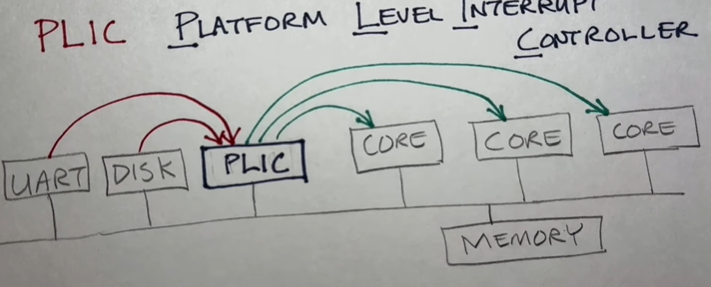
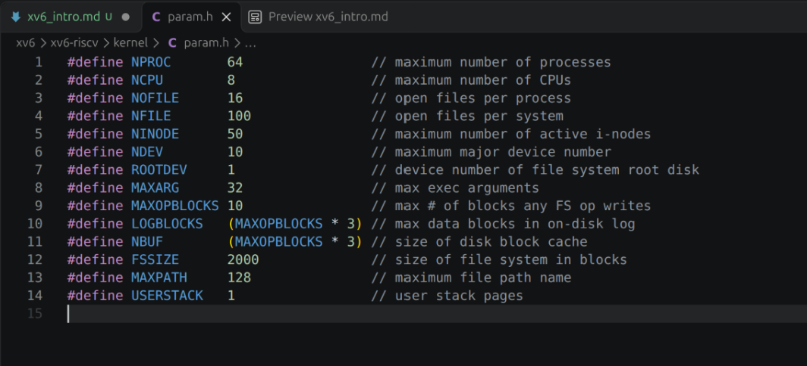
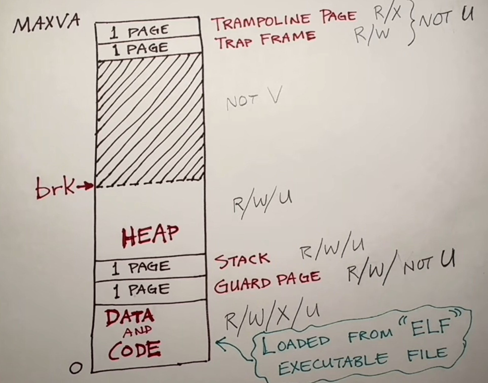

# XV6

## What is XV6?

Educational sw developed by MIT to teach OS, not practical for production use

XV6 runs on 64 bit RISC V Machine

targeted to bare metal

you will be running this in laptop using emulator - QEMU

around 6000 lines of C code, 300 lines in RISC V ASM language. Actual unix systems have aroun 10 - 30 million lines of code

XV6 device driver is limited (UART , DISK)

## Features

- Process
- Virtual address spaces
- files
- mutli tasking
- multi core
- 21 system calls 


production OS have more than 500 system calls

some user programs you can find in XV6:
- sh
- cat
- echo
- grep
- kill
- ln
- ls
- mkdir
- rm
- wc

XV6 is a true unix operating system

## System calls supported

- fork()
- wait()
- exit()
- pipe() : creates communication pipes to send bytes
- open()
- close()
- kill()
- exec()
- mknod() : setup a new device
- unlink() : deletes a file
- fstat() : retrievs info about a file
- mkdir()
- chdir()
- dup : coping file descriptor
- getpid()
- sys_sbrk() - increases the heap , system break
- pause() - puts the task to sleep, similar to sleep
- uptime() - you can see how long the kernel is running, usually in ticks


# XV6 internals

XV6 is designed to run on a shared memory processor with summetric mutliprocessor

Core, CPU, Processor , HART mean the same thing

HART - Hardware thread

each core executed a single HART here

main memory (RAM) is shared

Caches are ignored in this kernel

#define PHYSTOP 128 -> 128 Mbytes

No real hw , emulated by QEMU - we have UART and disk (QEMU uses .img file), TIMER(used for time slciing one per core), PLIC - platform level interrupt controller

<p align="center">
  
</p>

PLIC selects the core to handle the interrupt

### Memory :

Page size : 4kb, #define PGSIZE
Free list of pages - simple linked list
When page not needed, pages added to free list
No variable sized allocation
no malloc or calloc used (not in the kernel)
page tables are 3 levels deep, one page per process and 1 page table for kernel
each page marked with V/R/W/X/U flags (explained more in mem management)

### Processor mode:

Each core will be running user / kernel mode
the kernel switches to user mode to run application code
supervisor mode is also called as kernel mode
in risc v also have machine mode

### Scheduler:

Time slices - 1,000,000 cyles

A process can be runnable, running, sleeping

scheduling here is round robin scheduling - ready list (ready queue / run queue)

all cores share the single ready list

ready list is a array of each element being a struct, size of array is 64 -> 64 process can run at one time

each core is running the scheduler algorithm independently 

Each core has its own index to ready list

Boot sequence:

not relevant here, QEMU does everything

All the .c and .s file is compiled and created as one exe file

to run kernel you will use QEMU and place it at 0x8000 0000

starts execution at _entry on all cores

### Locking:

- acquire()
- release()

lock = 0, free
lock - 1, locked

shared data must always be protected by lock

locks:
- spinlocks : tight loop,waiting for lock to become free
- sleeplocks : if busy, put process to sleep. when released, wake up sleeping process


sleep() , wakeup() - self explaintory

disable interrupts - hardware enable/disable interrupt to prevent interruption

Parameters mod file:

<p align="center">
  
</p>

XV6 searching is linear search - for example, kill() - passed PID nd searches the process array based

### user address space


<p align="center">
  
</p>

data and code have the flags r/w/x/u. Guard page is not executable

here heap grows upwards - XV6 convention

How does malloc work() - user mode function, this will use heap space

user cannot read / write the trampoline and trap frame

Trampoline page is shared by all process

### Virtual address

Mutiple page table schemes supported by RISC V:
SV32
SV39 (XV6 uses this)
SV48
SV57

even its a 64 bit machine, the address is limited to 38 bits by XV6, SV39 uses 39 bit address

2 ^ 38 = 256 GB


## File structure

Kernel.ld - linker script

user -> init.c 

power on -> entry.s -> start.c -> main.c

entry/start in machine mode and main in supervisor mode

stack is controled by SP register

main.c : check this file in user folder

```
// start() jumps here in supervisor mode on all CPUs.
void
main()
{
  if (cpuid() == 0) { // checks if running on core 0, cpuid return the core/CPU number
    consoleinit(); //uart device, printf prints to console
    printkinit(); //printk init, i think printk means print kernel
    printk("\n"); //since we cannot use standard user libraries, we need to write our own , for this is present in printk.c
    printk("xv6 kernel is booting\n");
    printk("\n");
    kinit();            // physical page allocator
    kvminit();          // create kernel page table
    kvminithart();      // turn on paging
    procinit();         // process table
    trapinit();         // trap vectors
    trapinithart();     // install kernel trap vector
    plicinit();         // set up interrupt controller
    plicinithart();     // ask PLIC for device interrupts
    binit();            // buffer cache
    iinit();            // inode table
    fileinit();         // file table
    virtio_disk_init(); // emulated hard disk
    userinit();         // first user process

    __atomic_store_n(&started, 1, __ATOMIC_RELEASE);
  } else {
    while (__atomic_load_n(&started, __ATOMIC_ACQUIRE) == 0) //started will be set to 1 when core 0 has completed
      ;

    printk("hart %d starting\n", cpuid());
    kvminithart();  // turn on paging
    trapinithart(); // install kernel trap vector
    plicinithart(); // ask PLIC for device interrupts
  }

  scheduler(); //each core goes to scheduler and starts executing scheduler
}
```

