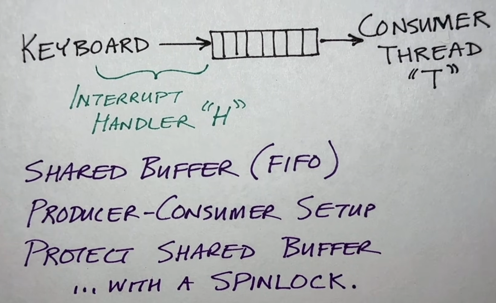

# Locking

## Rules for locking
- shared data must be protected
- Prevent deadlock

Shared data accessed by only one thread at a time - mutually exclusive

shared data - simple / complex

spinlock - mutex
lock state: 0 - unlocked/released, 1 - locked/acquired

.
.
.
ACQUIRE LOCK
.
.
R/W SHARED DATA (MUTUAL EXCLUSIVE) - this section is called critcial section
.
.
RELEASE LOCK

Reader- writer locks : mutiple threads to access data as long as they are reading, every writing thread has mutually exclusive access.

Kernel is a concurrent program

must know which lock protects which data!

Spinlock implementation:

```
// Mutual exclusion lock.
struct spinlock {
  uint locked; // Is the lock held?

  // For debugging:
  char *name;      // Name of lock.
  struct cpu *cpu; // The cpu holding the lock.
};

```

Each lock can be given a name, eg : name = "my_lock"

each lock has a structure called CPU, one cpu struct for each core

Functions:
- acquire()
- release()
- initlock()
- holding() - error check to check if we are currently holding the lock

acquire basic implementation:

(Incorrect implementation)
LOOP
    if *locked == 0
        *locked = 1
        return (lock is now set)
END LOOP

why? - XV6 runs on multicore system which means there can be multiple threadwes executing simulatenously consider a scenario where 2 threads look for locked at same time , both acquire it and both do the mod. Which breaks the system

RISC V has instruction to prevent this

AMOSWAP - Atomic mem operation swap
- Retrievs the previous value
- store new value in same mem

So this operation enforces that if you a thread is reading, it will ensure that it will do the write as well, preventing other threads to access the memory during this time

LOOP

    (AMOSWAP - in 1 operation)
    prev <- *locked (is previous value not 0 which means another thread holding lock)
    *locked <- 1

    if prev == 0
        return (lock is now set)
END LOOP (goes back to LOOP)

    
Release : locked <- 0

Init function - check the spinlock.c in XV6 kernel
```
void initlock(struct spinlock *lk, char *name)
{
  lk->name = name;
  lk->locked = 0;
  lk->cpu = 0;
}
```

Holding:
```
// Check whether this cpu is holding the lock.
// Interrupts must be off.
int holding(struct spinlock *lk)
{
  int r;
  r = (lk->locked && lk->cpu == mycpu()); //check if the CS(critical section) is locked and by the same core
  return r;
}
```


Acquire:
```
// Acquire the lock.
// Loops (spins) until the lock is acquired.
void
acquire(struct spinlock *lk)
{
  push_off(); // disable interrupts to avoid deadlock.
  if (holding(lk))
    panic("acquire"); // the problem is the same core is holding the lock and acquiring it again, rasing a situation of panic - panic prints message and terminate kernel

  // On RISC-V, __atomic_exchange_n turns into an atomic swap:
  //   a5 = 1
  //   s1 = &lk->locked
  //   amoswap.w.aq a5, a5, (s1)
  //
  // Passing __ATOMIC_ACQUIRE to __atomic_exchange_n tells
  // the C compiler and the processor to not move loads or stores
  // past this point, to ensure that the critical section's memory
  // references happen strictly after the lock is acquired.
  while (__atomic_exchange_n(&lk->locked, 1, __ATOMIC_ACQUIRE) != 0)
    ;

  // Record info about lock acquisition for holding() and debugging.
  lk->cpu = mycpu();
}
```

Release lock:
```
// Release the lock.
void release(struct spinlock *lk)
{
  if (!holding(lk))
    panic("release");

  lk->cpu = 0;

  // Release the lock, equivalent to lk->locked = 0.
  //
  // This code doesn't use a C assignment, since the C standard
  // implies that an assignment might be implemented with
  // multiple store instructions.
  //
  // On RISC-V, __atomic_store_n turns into a single atomic store:
  //   s1 = &lk->locked
  //   fence rw,w
  //   sw zero,0(s1)
  //
  // The __ATOMIC_RELEASE argument to __atomic_store_n tells the
  // the C compiler and the CPU to not move loads or stores past
  // this point, to ensure that all the stores in the critical
  // section are visible to other CPUs before the lock is released,
  // and that loads in the critical section occur strictly before
  // the lock is released.
  //
  // On RISC-V, this generates a fence instruction before the store:
  //   fence rw,w
  __atomic_store_n(&lk->locked, 0, __ATOMIC_RELEASE);

  pop_off(); // push and pop are paired , pop enables the interrupt , and push disables the interrupt
}
```

Spinlock never be hekd for a long time, acquire spins in loop wasting exewcution cycles

Other locking techniues:
- Sleeplock
- semaphores

go to sleep while waiting

acquire -> access -> release

With spinlock what if it gets preempted while the previous thread has the lock , and now waits for another new thread to finish its execution. This can cause huge delay

solution:
to prevent interrupts, disable interrupts while processing

A producer-consumer problem:

<p align="center">
  
</p>

Shared buffer - CS
Interrupt handler - H
Consumer thread - T

Lets say, 
H does ... acquire(lock) -> add to buffer -> release(lock)...

T does ...acquire(lock) -> remove a char -> release (lock) ...

Now the problem we see is, what if new char is entered in keyboard even the lock is acquired by thread T , the interrupt handler will wait for the lock to get release resulting in *dead lock**

solution : disable and enable the interrupts, disable in acuire and enable in release


## Nested locks

```
acquire(lock1)
acquire(lock2)
acquire(lock3)
//CS
release(lock3)
release(lock2)
release(lock1)
```

APPRAOCH:

push_off and pop_off they work in stack fashion

push_off will disable the interrupt and increment lock counter and pop_off decrement the counter and enable interrupt if counter reaches 0(meaning no ,lock acquired)

// push_off/pop_off are like intr_off()/intr_on() except that they are matched:
// it takes two pop_off()s to undo two push_off()s.  Also, if interrupts
// are initially off, then push_off, pop_off leaves them off.


```
void
push_off(void)
{
  // disable interrupts to prevent an involuntary context
  // switch while using mycpu().
  uint64 flags = rc_sstatus(SSTATUS_SIE);
  int old = !!(flags & SSTATUS_SIE);

  if (mycpu()->noff == 0)
    mycpu()->intena = old; // old has the previous interrupt enable / disable state
  mycpu()->noff += 1;
}

void
pop_off(void)
{
  struct cpu *c = mycpu();
  if (intr_get())
    panic("pop_off - interruptible");
  if (c->noff < 1)
    panic("pop_off");
  c->noff -= 1;
  if (c->noff == 0 && c->intena)
    intr_on(); //interrupt enable/ON
}
```
So if you check the acquire you will have push at start and if you check release it will have pop at end


